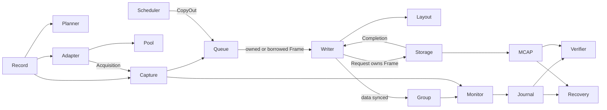

# レコーダーの構成

V1 の単一入力は従来の CLI で利用できる。config を渡すと V2 の複数入力パイプラインが起動する。V3 用 config は同じパイプラインのソースと checkpoint を拡張する。

- `record` は設定、起動順、アダプター生成、スレッド join、サマリを担当。 `capture` は次の取得イベント、キュー投入と取得欠損を担当する。ソースの種類に応じた生成と能力の制約は adapter/mock が担当する。
- `layout` は MCAP のバイト配置と CRC、`storage` は positional I/O と completion、`writer::group` は commit 用 ID・状態・範囲を扱う。`integrity` は bounded イベントキューの消費、監視、journal を担当する。
- Verifier と Recovery は記録スレッドとは独立してファイルを読む。Verifier が正常終了と予定件数を照合し、Recovery が不完全ファイルに残る証拠を走査する。
