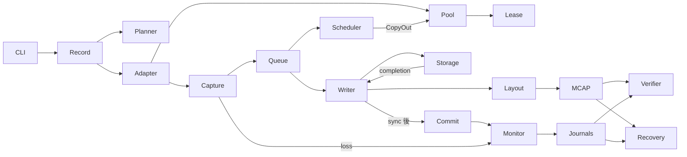

# リファクタリング前の監査

開始時は初回コミット前で、既存ファイルを含む作業ツリーが未追跡。V3 のビルド済みバイナリ、CLI 出力、MCAP と各 sidecar を target/v3-evidence に保存。V3 の未達は [V3 検証報告](v3-report.md) に記載。

- record.rs に CLI 合成、ワーカー起動、取得ループ、監視レポートが集中。取得ループが ScheduledSource の構築も担当するため、アダプターを差し替える境界が呼び出し側に露出していない。取得処理を分離し、アダプターは録画の合成箇所で組み立てる。
- writer.rs で MCAP offset、I/O 完了、グループ内 ID と状態、障害時の分類を同時に扱う。コミットグループの内部状態と ID 範囲の発行を専用モジュールに移す。Storage の I/O と Layout の形式は既存境界を維持。
- 取得 → Lease → Queue → Borrow/CopyOut → Writer → Storage completion がホットパス。ファイル checkpoint は data sync → グループとメンバーの JSONL → ledger sync。モニターの checkpoint 状態を切り出し、書込み順とキュー深度への影響を固定する。
- Pool の Lease はムーブ専用。Device Lease を保持する fence 待ちと I/O による借用は別の状態。cancel は元 request の completion を代替しない。io_uring の unsafe は NOP と stable slot の submission に限定。FFI と実 DMA mapping は未導入。
- short write、EIO、ENOSPC、sync 失敗、copy 失敗、キュー・プール圧迫、期限逸脱、cancel、SIGTERM、SIGKILL、破損 CRC、末尾切断を既存テストと V3 テストで評価。OOM は起動時の予算と事前確保で抑制する。OS の強制 OOM kill、電源断、rename/ディレクトリ sync の故障、全 crash 境界は未検証。
- 作業順は (1) 既存回帰と golden の固定、(2) capture と adapter 合成の分離、(3) commit group と journal の責務分離、(4) 同条件で再測定。型や unsafe の大規模変更と最適化は今回の対象から外した。
