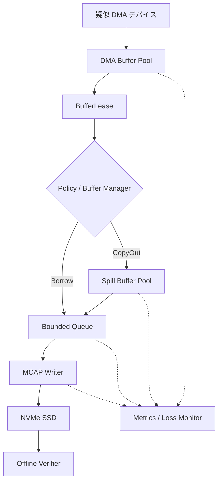

# 高帯域 MCAP Recorder V1 — PoC 実装仕様書

対象：Codex による初期実装。2026-11-22 時点の設計方針。

## 1. 目的

自律移動ロボット・自動運転向けの、高帯域かつ欠損を監視できる非圧縮 MCAP レコーダーを開発する。

V1 は完成品ではなく、次の仮説を実機 SSD と疑似センサによって検証するための PoC である。

1. 定常的にストレージへ書き切れる入力負荷であれば、有限のバッファによって一時的な書込み停滞を吸収できる。
2. デバイスの DMA バッファを借用し、必要になった場合だけ自前の RAM にコピー退避することで、常時コピー方式よりもコピー量と CPU・メモリ負荷を削減できる。
3. バッファの所有権と返却期限を明示し、性能・欠損を監視することで、録画可能な条件と限界を定量的に把握できる。
4. 録画結果を独立に検査し、欠損・重複・破損を見逃さない仕組みを実現できる。

最終的な想定入力は ROS 2、UDP、SocketCAN、V4L2、Solectrix proFRAME 3.0、NVIDIA DRIVE AGX Orin / Thor（NvSIPL）など。V1 はこれらの実機 SDK に依存せず、疑似 DMA デバイスで所有権とバッファ枯渇を再現する。

## 2. スコープと優先順位

### 必須

- Linux 上の Rust CLI プログラム。通常の PC で動作すること。
- 固定周期・固定サイズの疑似センサ、有限の疑似 DMA バッファプール。
- 最小の BufferLease（所有権、取得時刻、返却期限、返却処理）。
- 事前確保した退避用バッファプール、上限付きキュー。
- Always Copy / Always Borrow / Adaptive の三方式を同一条件で比較可能。
- 非圧縮の仕様準拠 MCAP 出力。実 SSD への書込み。
- 遅延・帯域低下の注入、性能監視、欠損記録、録画後の独立検証。
- ユニットテスト、結合テスト、再現可能なベンチマーク手順。

### V1 では実装しない

- 実際のカメラ、ROS 2、UDP、CAN 等の Adapter; 実 DMA の割当、デバイス固有のバッファ交換。
- 汎用プラグイン機構、複数センサの複雑な調停、動的期限計算、I/O 所要時間の予測制御。
- io_uring、O_DIRECT、AF_XDP、DPDK、独自カーネルドライバ。必要性を V1 の測定で判断する。
- クラッシュをまたぐ exactly-once トランザクション、WAL、電源断耐性、複数ストレージへの複製。
- GUI、ネットワーク監視サーバ、ファイルローテーション、圧縮、ROS 2 bag メタデータ生成。

V1 で目指すのは固定条件での正しさと計測可能性であり、無条件の無欠損保証や製品品質の達成ではない。

## 3. 論理アーキテクチャ



基本構成は、疑似センサ／退避処理を行う一つの取得スレッドと、一つの専用 Writer スレッドでよい。計測の集約は別スレッドまたは実行後に行い、データパスをモニタ出力でブロックしない。

V1 では取得スレッドが新規フレームについて Borrow / CopyOut を決定する。Writer に渡したキュー内のフレームを後から書き換える機構や、I/O 中のバッファを強制回収する機構は不要。

## 4. 疑似 DMA デバイス

### 4.1 入力モデル

- 単一ストリーム、固定フレームサイズ `frame_bytes`、固定発生頻度 `fps`。
- 生成予定フレームごとに `u64` の連番（0 起点）、ストリーム ID、発生時刻を付与する。
- 単調時計に基づく絶対時刻スケジュールを使用し、前回処理完了からの相対 sleep の累積による入力レート低下を避ける。
- スケジュール超過や利用可能バッファ枯渇によって生成できなかったフレームも、予定連番を消費し、理由を記録する。入力の無意識な減速によって欠損ゼロを装わない。
- 各フレームのペイロードはストリーム ID / 連番 / seed から再現できる決定的パターンで埋める。全バイトを検査可能にし、未初期化領域を読み書きしない。
- データ生成時間そのものが性能を左右するため、その時間を別計測する。必要なら単純な高速パターンを選び、暗号学的乱数の生成をホットパスで行わない。

### 4.2 DMA バッファプール

- 起動時に `dma_buffers` 個、各 `frame_bytes` の領域を事前確保する。
- 初期化時にページをタッチし、実行開始後の初回ページフォルトによるノイズを減らす。
- デバイスは空きバッファのみを選び、データを生成して Lease を発行する。空きがなければそのフレームは欠損扱いとする。
- `capture_reserve` は Adaptive が撮影継続のため確保したい空きバッファ数。実機では内部パイプライン占有分も含めて決めるが、V1 では任意に設定する。
- 必ずプールの総数、空き数、保持数を観測できるようにする。バッファ ID は再利用できるが、フレーム ID は別管理する。

## 5. BufferLease とメモリ所有権

### 5.1 最小設計

以下はデータ契約を示すイメージであり、具体的な型やモジュール名は実装に合わせて調整してよい。

```rust
struct BufferLease {
    buffer: PoolBuffer, // バッファを一意に所有するハンドル
    acquired_at: Instant,
    return_deadline: Instant,
}

enum Payload {
    Borrowed(BufferLease),
    Owned(SpillBuffer),
}

struct Frame {
    stream_id: u16,
    sequence: u64,
    capture_time_ns: u64,
    payload: Payload,
}
```

- Lease は `Clone` / `Copy` 不可の所有権付きハンドルとし、キューや Writer 間で move する。バッファ本体の移動でペイロードを複製しない。
- Lease が有効な間は疑似デバイス側がそのバッファを再利用・上書きしてはならない。
- `Drop` など RAII を利用して一度だけプールへ返却する。通常終了・エラー・キュー投入失敗時にもリーク、二重返却、use-after-release が発生しないこと。
- Rust の安全なコードを優先し、アロケーション済みの `Box<[u8]>` などを所有権で移譲してよい。性能上必要な場合を除き unsafe は導入しない。
- return_deadline は取得時刻 + 設定可能な `max_hold_ms` とする。V1 ではこの固定期限は計測・判断のためのソフト期限であり、厳密な最大保持時間の証明は対象外。超過は必ずカウント・報告する。
- 返却期限を過ぎても他者が参照中のバッファを強制返却・上書きしてはいけない。I/O 完了まで所有権を保持する安全性が優先される。

### 5.2 CopyOut

1. 退避プールから空きバッファを取得する。
2. Lease の有効な範囲を退避領域へコピーする。
3. コピー完了後に初めて元の Lease を返却する。
4. 退避済みの `Owned` ペイロードを Writer キューへ移譲する。
5. 書込み処理完了後、退避バッファを退避プールへ返却する。

退避プールも起動前に固定数を確保する。退避領域が枯渇しても動的に増やさない。安全に Borrow できなければ欠損として記録する。

### 5.3 不変条件

- DMA プールの `free + leased = total`（排他的な状態として計数）。
- 退避プールでも同様の保存則が成立する。
- 各ペイロードの所有者は常に一つ。CopyOut のコピー中のみ元・先の両バッファを処理主体が保有する。
- Writer の `write` が元のデータを参照している間、他スレッドから返却しない。
- 正常終了時、全バッファが各プールに返却されている。
- データパスのメモリ使用量は入力個数・録画時間に比例して増えない。MCAP ライブラリ内部のインデックス等の追加領域は別途把握する。

## 6. 比較する三方式

| Policy | 受信時の動作 | 想定される弱点 |
|---|---|---|
| Always Copy (`copy`) | 退避プールに全フレームをコピーして DMA バッファを即時返却 | 定常的なコピー負荷、退避プールの枯渇 |
| Always Borrow (`borrow`) | 元の Lease をそのまま Writer へ渡し、書込み処理完了後に返却 | SSD 停滞時の有限 DMA プール枯渇 |
| Adaptive (`adaptive`) | 空きが十分なら Borrow、不足し始めたら新規受信データを CopyOut | 閾値設定、有限の退避領域、既に保持中の Lease |

Adaptive の V1 ルール：取得直後の空き DMA バッファ数が `capture_reserve` 以下なら CopyOut、そうでなければ Borrow。ヒステリシスや予測はなくてよい。退避失敗時に予約枠を消費して無断で Borrow することは禁止し、欠損として分類する。キューが満杯の場合も黙って入力をブロックせず、欠損として分類する。

このルールはプール枯渇を抑えるためのもので、過去に Writer へ渡した個々の Lease の固定返却期限を必ず守れることは意味しない。期限超過を測定し、V2 の調停設計の材料とする。

方式比較のメモリ予算を公平にするため、DMA バッファ数・退避プール数・キュー上限は原則同一にする。設定上の総確保量と実際のピーク使用量を両方記録する。

## 7. Writer / MCAP

- 単一 Writer スレッドで出力順序とファイル更新を管理する。初期実装では同期 I/O とする。
- MCAP の公式 Rust ライブラリの利用を優先。非圧縮で正しい MCAP を生成し、独自フォーマットへの置換をしない。
- V1 の初期経路は Chunk 無効の非圧縮 Message 直接書込みでよい。これは高速シーク用インデックスがない可能性があるため、README に明記する。非圧縮 Chunk + Index は追加実験扱いとし、適応退避検証を遅らせない。
- Schema / Channel を適切に登録し、Message の `log_time` / `publish_time`、sequence を設定する。ペイロードの先頭等にも完全な `u64` のフレーム ID を持たせ、MCAP の 32-bit sequence の周回に依存しない。疑似データの独自 encoding を文書化する。
- 必要なら同期 `writev()` を別の比較 Backend として導入するが、仕様準拠・部分書込み処理・ファイルの整合性を優先する。既存ライブラリを用いる場合、その内部コピーやバッファリングを明示し、アプリケーションがコピーを減らしたことと end-to-end zero-copy を区別する。
- 書込みの成功結果・部分書込み・エラーを正しく扱う。データ破損が疑われる書込みエラーでは録画を停止し、既知の欠損／未確定範囲を報告する。単純な append の全体再試行で重複を作らない。
- 正常終了時はキューを drain し、MCAP footer まで finalize し、ファイルの flush と sync（`sync_data` または `sync_all`）を実行する。同期成功・失敗および所要時間を別途記録する。
- バッファ返却時点は Writer が入力メモリを参照しなくなった時点であり、SSD 永続化時点とは区別する。V1 の録画結果の保証は正常終了・同期成功・検証成功の場合に限定する。
- シンクの比較として MCAP の実ファイル出力と、実 I/O をしない NullSink を用意する。NullSink の結果を SSD 性能として報告しない。

参考：MCAP 仕様 https://mcap.dev/spec

## 8. 完全性と欠損検知

### 8.1 V1 の保証範囲

疑似センサには全予定フレームの ID が既知という利点があるため、生成／受理／出力／欠損の全量照合を行う。

正常終了時の不変条件（集合として、積集合が空であることも確認）：

```text
予定フレーム = 正常受理 + 発生・取得段階の欠損
正常受理     = 保存済み + 受理後の欠損
```

`保存済み` は最終的に MCAP を外部から読み返して検証したフレームを指す。Writer のカウンタだけで成功と判定しない。

### 8.2 欠損記録

原因を少なくとも以下に区別する。

- `source_deadline_miss`：疑似センサの生成処理遅延等。
- `dma_pool_exhausted`：デバイスで利用可能なバッファなし。
- `spill_pool_exhausted`：退避先なし。
- `queue_full`：Writer キューに受理できない。
- `writer_error`：書込み失敗。
- `unknown`：終了異常などで保存状態を確定できない。

欠損イベントは `stream_id`, `sequence` または連続した範囲, `timestamp`, `layer`, `reason` をサイドカー JSONL 等に記録する。実行時間に比例する巨大なメモリ上の欠損リストを持たず、連続範囲の圧縮や上限付き集約を行う。欠損監視自身のイベント溢れや報告失敗も成功扱いにしない。サイドカーを別スレッドで集約する場合も上限を明示する。

V1 の欠損ログは同一 SSD 上でもよい。SSD 故障や電源断に対して欠損記録の永続化を保証する機能は V2 以降。エラー終了時は未確定範囲と検証可能性を示し、無条件に欠損と断定したり exactly-once を宣言しない。

### 8.3 独立 Verifier

`verify` コマンドを作る。MCAP と実行時の結果ファイルを読み込み、少なくとも次を検査する。

- expected / received / written / verified の件数と連番集合。
- 同一 `(stream_id, sequence)` の重複、範囲外、欠落、単一ストリーム内の順序違反。
- フレームサイズ、ID、全ペイロードの決定的パターンの一致。
- 検出した欠損と欠損記録の一致（未申告欠損・誤申告・重複申告がないこと）。
- MCAP 読込みエラー、正常 finalize の有無。

全 payload を一度にメモリへ読み込まず、逐次処理すること。検証には録画時の Writer の実装と独立した MCAP Reader を使う。失敗時は非ゼロの終了コードを返す。

## 9. 監視と計測

記録時のホットパスは軽量なカウンタ、ヒストグラム、固定容量のサンプル等を利用する。フレームごとの詳細ログ出力をデフォルトで有効化しない。計測のためのヒープ増加や同期を最小限にし、それでも監視自体の負荷を記録する。

| 分類 | 必須計測項目 |
|---|---|
| Input | 予定・生成・受理フレーム数、入力 bytes/s、生成遅延、生成時間 |
| DMA | 空き数、最小空き数、保持数、保持時間、返却期限超過数、最大超過時間 |
| Spill | 空き数、ピーク使用バイト、コピー回数とバイト数、コピー時間 |
| Queue | 深さ、ピーク深さ、キュー待機時間、満杯回数 |
| Writer | 書込み件数・bytes/s、書込み呼出し時間、エラー、同期時間、終了時 drain 時間 |
| Process | CPU 使用率または CPU time、RSS/ピーク RSS、壁時計時間 |
| Integrity | レイヤー別欠損数、欠損イベント記録失敗、Verifier の重複・破損・未申告欠損数 |

- 遅延は min / mean / p50 / p95 / p99 / p99.9 / max を可能な範囲で集計し、サンプル数も表示する。短い試験で p99.9 を過大解釈しない。
- 100 ms 程度を初期値とする設定可能な periodic metrics CSV を作成し、プール残量・キュー深さ・累積コピー数・入出力帯域・欠損数が時系列で分かるようにする。
- 終了時に機械可読な JSON サマリを出力する。比較しやすい単位（bytes、ns、秒等）と設定値を明示する。
- 閾値割れ、退避枯渇直前、返却期限への接近などを警告として出す。警告と実欠損は区別する。
- 可能なら OS 側の計測手順（`iostat -x`、`pidstat`、`perf stat` 等）を README に記載する。必須依存にはしない。

## 10. 遅延・障害注入

Writer スレッドの実際の処理を一時停止できる機構を作り、取得・退避・監視スレッドは停止させない。ソフトウェアで挿入した停止は実 SSD 内部の遅延そのものではないため、結果に明記する。

- 指定時刻の単発 stall（例：録画開始 2 秒後に 250 ms 停止）。
- 定期 stall（周期と停止時間を設定）。
- Writer の帯域制限（一定時間あたりの処理能力を制限）。
- 単体テスト用の write error / short write 等の疑似障害。ライブラリ側が処理を担当する場合はその性質を明示する。

遅延を入れる箇所を明示する。少なくとも Writer がキューを消費しない状態を再現する。可能なら、Writer が一つのフレームを所有中の遅延も再現し、その Lease が途中で返却されないことをテストする。

## 11. CLI と実行結果

CLI の名称・具体的なオプション構文は変更可。ただし以下の設定を CLI または設定ファイルで変更できるようにする。

```text
recorder record --policy adaptive --sink mcap --output run.mcap \
  --frame-bytes 4194304 --fps 240 --duration-sec 5 \
  --dma-buffers 32 --capture-reserve 4 --spill-buffers 128 \
  --queue-capacity 160 --max-hold-ms 1000 \
  --stall-at-ms 2000 --stall-duration-ms 250

recorder verify --input run.mcap --report run-summary.json --loss-log run-loss.jsonl
```

この例は約 1.007 GB/s（4 MiB × 240 fps）の高負荷構成であり、6 台 × 40 fps 相当の集約入力を疑似単一ストリームで表している。実デバイスの直接的な再現ではない。

生成物：

- `run.mcap`：非圧縮データファイル。
- `run-summary.json`：全設定、実測値、欠損数、終了状態、seed 等。
- `run-metrics.csv`：時系列計測。
- `run-loss.jsonl`：欠損範囲と要因。
- Verifier の標準出力／JSON レポート（検査結果）。

入力検証：正の frame サイズ・fps・期間、`capture_reserve < dma_buffers`、キューとプールの容量、整数オーバーフロー等をチェックする。実行前に予想データ量とメモリ確保量を表示する。

**安全に実行すること：** デフォルトは小容量のスモークテスト。既存出力を上書きしない。容量の大きな SSD 負荷実験は出力先・利用可能なディスク空間を確認し、ユーザーが明示的に実行する。CI では数十 MiB 以下程度で完了する試験を使用すること。長時間 1 GB/s 記録は 1 分で約 60 GB を消費する。

## 12. 実験計画

最初に実機 SSD の持続書込み能力を確認し、入力より出力が速い条件を作る。ページキャッシュの短時間の見かけの性能と、SSD への持続的な記録性能を分けて報告する。十分な測定領域やキャッシュ枯渇後の結果が得られない場合は、制約として記載し断定しない。

| ID | 実験 | 比較・期待結果 |
|---|---|---|
| E0 | NullSink + 疑似入力 | 生成処理・プール・キューの性能上限を把握 |
| E1 | 正常負荷、stall なし | 3 方式とも無欠損。Borrow / Adaptive の明示的コピーが Copy より少ない |
| E2 | 短時間 stall | DMA 枯渇前に復帰する条件では Borrow / Adaptive とも無欠損 |
| E3 | DMA 容量を超える一時 stall、十分な退避容量 | Borrow で欠損、Copy / Adaptive で無欠損となることを検証 |
| E4 | 退避容量も超える stall | 有限容量である以上の欠損が生じること、欠損記録が全て一致することを検証 |
| E5 | 復帰後の catch-up と連続 stall | 滞留量の回復、再停止への耐性、警告動作を観測 |
| E6 | 恒常的な入力超過 | メモリ使用量が無制限に増えず、全欠損を検出できること |
| E7 | SSD 実ファイル、高帯域 | 実環境の書込み・同期時間・CPU/RSS 変動、各方式の差を評価 |

同じ seed、同じフレーム数、同じプール・キュー容量、同じ stall 設定で各方式を比較し、試行を再実行できるようにする。複数回の測定結果を集計する場合、個別結果も残す。

入力の概算 `R = frame_bytes × fps`。出力が完全に停止する時間 `T` に必要な追加領域の下限は `R × T`。再開後に滞留を解消するには持続的な出力速度が入力速度を上回る必要がある。停止前の滞留、同期したバースト、安全余裕、管理領域も実際には加算される。

例：4 MiB × 240 fps、DMA 32 個（予約 4 個）、Spill 128 個の場合、250 ms 停止中に約 60 フレームが発生。録画開始時の滞留が小さく、キュー・コピー性能が十分なら、Adaptive がコピー退避で吸収する仮説を検証できる。実環境での無欠損の保証値ではない。

## 13. テストと合格条件

### ユニット／結合テスト（必須）

- Lease を move、drop して元のプールへ正確に一度だけ返却。
- キュー投入失敗、退避先なし、停止要求、Writer エラーでバッファリークしない。
- コピー完了前および Writer が保持中のバッファを再利用しない。
- 擬似デバイスの予定 ID、プール枯渇時の欠損 ID を正しく計数。
- Adaptive の閾値境界と、退避プール枯渇時の動作。
- 正常終了後の全プール返却、キュー drain。
- MCAP round-trip、連番・サイズ・payload 一致。
- Verifier が意図的な欠損、重複、破損、欠損ログ不一致を検出。
- エラー発生時に非ゼロ終了または明示的な degraded/error 状態を報告。

タイミング依存のテストは可能な限り決定的にする。テストスレッドの同期や疑似時刻を用い、短い sleep 時間だけに期待して flaky なテストにしない。性能テストと機能テストは分離する。

### V1 完了判定

1. `cargo fmt --check`, `cargo clippy --all-targets`, `cargo test` が通る。
2. 三つの Policy で正常な MCAP を出力し、公式 MCAP Reader で検証成功する。
3. 正常負荷と十分なストレージ／退避容量の条件で、未申告欠損・重複・payload 破損がゼロである。
4. 過負荷で欠損が実際に発生しても、Verifier で検出した欠損と欠損ジャーナルが一致する。
5. 事前に設計したプール容量を超えてペイロード領域を動的に増やさない。正常終了時には全バッファが返却されている。
6. 同じ stall シナリオで Always Borrow の限界と Adaptive の改善を再現し、Always Copy と比べたコピー量を数値化できる。
7. 監視結果から入力、Writer、DMA 保持、退避、同期のどこが律速かを推測できる。
8. 1 GB/s を性能目標とし、実際に達成した持続速度を報告する。未達でも、ハードウェアや実装上の律速を測定データで説明できるなら PoC として成功。架空のベンチマーク結果を書かない。

## 14. 実装順序と成果物

| Step | 実装 | 完了の目安 |
|---|---|---|
| 1 | Cargo プロジェクト、疑似入力と非圧縮 MCAP Writer | 小さな MCAP の生成・読戻し |
| 2 | 事前確保プール、BufferLease、上限付きキュー | RAII と所有権不変条件のテスト |
| 3 | Always Copy / Always Borrow | 同一入力の比較が可能 |
| 4 | Adaptive と固定返却期限の監視 | 閾値動作と欠損理由をテスト |
| 5 | 遅延注入、metrics、欠損ログ、Verifier | stall 条件で E1〜E6 を再現 |
| 6 | SSD 評価と改善点整理 | E7 の実際の測定、またはユーザー PC での再現手順 |

推奨ソース構成（厳密なディレクトリ指定ではない）：`source`, `pool`, `lease`, `policy`, `writer`, `metrics`, `verify`, `fault`, `main`。Rust の標準機能と実績ある小規模依存を優先し、V1 から過剰な汎用 trait やフレームワークを作らない。既存リポジトリがある場合はまず README / AGENTS.md / Cargo 構成を確認し、既存成果を保護する。

必須成果物は、ソースコード、テスト、CLI 使用方法、README の実験条件・仕様上の限界、および実行済みベンチマークの結果または再現コマンド。実装中に設計と矛盾する現象を発見した場合は、黙って保証を弱めず、判断理由を README に記載する。

## 15. V2 / V3 で検討する事項（情報共有のみ）

- V2：複数入力ごとの動的なバッファ返却期限／残量、スケジューリング、キュー内 Lease の退避、事前の容量・帯域検証、非同期 I/O、Replace 戦略。
- V3：各実デバイス Adapter、MCAP の索引・ローテーション、永続化トランザクション（固定オフセットによる冪等書込み、group commit 等）、クラッシュ復旧、外部監視と欠損報告の耐障害性。
- DRIVE AGX NvSIPL のようにアプリケーションが事前に登録した DMA プールからデバイスが空きバッファを使用する方式を想定する。撮影中に新規バッファ登録できるとは仮定しない。proFRAME SDK の具体的能力は実機 Adapter 作成時に確認する。

V1 の目的はこの将来設計の前提を実測・反証することである。高度な実装を追加するために V1 の検証完了を遅らせない。
