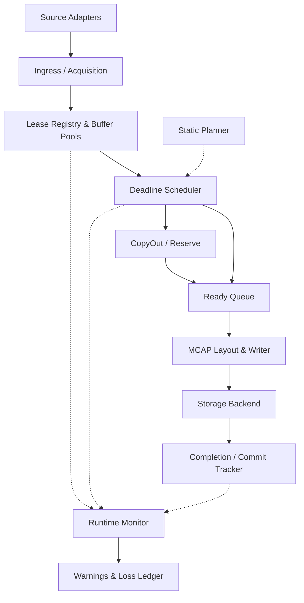
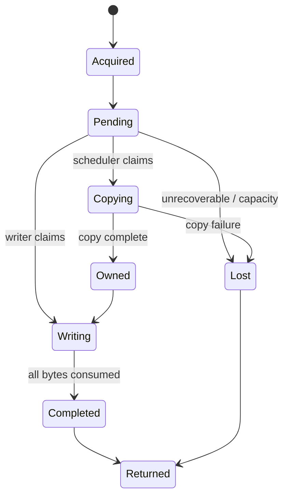

# 高帯域 MCAP Recorder V2 — アーキテクチャ検証・実装仕様書

対象：Codex による V1 の次世代実装。前提仕様：`robot-recorder-v1-spec.md`。

## 1. V2 の目的

V1 では、単一の疑似 DMA デバイス、固定バッファプール、BufferLease、固定閾値での CopyOut を用いて、コピー削減・SSD 停滞耐性・欠損検知の基本コンセプトを検証した（実際の達成状況は V1 の結果を確認すること）。

V2 ではこれを、**複数・異種の入力のバッファ制約に対して、事前に記録可能条件を分析し、実行中の状態に基づき退避方法を選択できるレコーダー Core** に発展させる。

検証したい仮説：

1. デバイス固有のバッファ取得・返却・同期を抽象化しても、高帯域と安全な所有権移譲を維持できる。
2. バッファプールの残量と入力の到着特性から、返却が必要になる期限を動的に導出できる。
3. 期限が接近したとき、キュー内の借用バッファを安全に CopyOut することで、固定閾値方式よりコピー量、欠損、予約メモリ量のいずれかを改善できる。
4. 事前の容量分析（Planner）と実行中監視を組み合わせ、保証の前提を外れる前に警告し、外れた場合は明示できる。
5. Writer に対して、投入・完了・永続化を分離した管理を行い、実行中の欠損・重複・未確定範囲を説明できる。

想定する将来の実機：Solectrix proFRAME 3.0、NVIDIA DRIVE AGX Orin / Thor（NvSIPL）、V4L2、ROS 2、UDP、SocketCAN 等。V2 は実機 SDK なしで再現できることを必須とし、実カメラ対応は V3 に残す。

## 2. 開発開始時の必須作業

V2 の実装前に、既存リポジトリと V1 の結果を確認する。

- AGENTS.md、README、Cargo 構成、テスト、V1 の計測結果を確認。
- V1 の 3 方式（Always Copy、Always Borrow、固定閾値 Adaptive）で基準実験を再現する。
- 既存のコードを破棄する前に、再利用可能な MCAP Writer、Verifier、疑似ソース、メトリクス、実験設定を特定する。
- V1 未達成事項、観測された律速、設計上の仮説と実測の相違を `docs/v1-retrospective.md` に記載する。実測値が存在しなければ不明と記載し、捏造しない。
- 必要な場合は Core を作り直してよい。ただし V1 の同条件比較ができるベースラインと成果物を残す。既存変更、ユーザーデータ、実験ログを無断で削除しない。

## 3. スコープ

### 必須機能

- Linux / Rust、必要最小限の FFI を隔離できる構造。
- Source Adapter の抽象化、複数疑似デバイス（異なる周期、サイズ、バースト、返却条件）。
- 固定期限型と共有プール型の BufferLease、各プールの残量・返却要求のモデル化。
- Borrow、CopyOut、事前登録予備バッファを利用する Replace / Pool Reserve 相当の動作を疑似実装。
- 取得後のキュー内 Lease を安全に退避できるスケジューラ。
- 起動前 Planner、実行中の保証条件監視、事前警告。
- 同期 Writer を維持し、非同期 Writer Backend を導入・比較できる設計。io_uring の実装は対象 OS で安全に利用できる場合に行う。
- 書込み ID・状態管理、グループ単位同期、既知の欠損・未確定範囲の記録、オフライン Verifier。
- V1 との比較、決定的なテスト、I/O・コピー遅延と異常の注入。
- 可能なら Linux 上で実際に 1 GB/s の持続記録を検証。ストレッチ目標 2 GB/s。未達の場合は律速を説明する。

### V2 では実装しない（V3 以降）

- proFRAME / NvSIPL / ROS 2 等の本番 Adapter、実 DMA の任意メモリ登録。
- 電源断・クラッシュをまたぐ exactly-once、完全な WAL リカバリ、SSD 二重化、外部への欠損ログ耐障害保存。
- 本番向けファイルローテーション、rosbag2 パッケージ互換、GUI、遠隔監視基盤。
- DPDK、AF_XDP、SPDK、無条件の Direct I/O、独自カーネルドライバ、GPU コピー最適化。

V2 内に実装する group commit は通常実行の永続化管理の検証であり、永続化済みチェックポイントを利用した再起動時の厳密なリカバリまでは要求しない。

## 4. 論理アーキテクチャ



核心は、Source Adapter、BufferLease、Scheduler、Writer、Commit Tracker が互いに異なる責務を持つこと。Writer は画像ドライバや DMA の種類を意識せず、Source は MCAP や SSD を意識しない。

データパスに利用する全キューには容量制限を設ける。大量の payload を逐次コピーする中央ロックや無制限キューを作らない。

## 5. Source Adapter 契約

実装イメージ（具体的な trait 名、同期／非同期方式は V1 の知見に応じて調整可能）：

```rust
trait SourceAdapter {
    fn capabilities(&self) -> SourceCapabilities;
    fn try_acquire(&mut self) -> Result<AcquireEvent, SourceError>;
    fn pool_status(&self) -> Option<PoolStatus>;
}

struct SourceCapabilities {
    source_id: SourceId,
    pool_id: Option<PoolId>,
    reclaim_model: ReclaimModel,
    replacement_mode: ReplacementMode,
    sequence_observable: bool,
    arrival_profile: ArrivalProfile,
    max_payload_bytes: usize,
}

enum ReclaimModel {
    Owned,
    PerBufferDeadline,
    PoolCapacity,
}

enum ReplacementMode {
    Unsupported,
    PreRegisteredPool,
    ExplicitReplacement,
}
```

- `try_acquire` がデバイスとの通知／同期処理を吸収する。疑似実装では時刻イベント、実装将来像では fd / callback / fence 等を Adapter ごとに扱う。
- Core に渡す payload は、読み出し可能な状態であること。実 DMA に対応するときは producer の EOF fence やキャッシュ整合性を確認する。未完成のフレームを Writer や CopyOut に渡さない。
- バッファ返却処理が別スレッドに中継される Adapter も想定する。RAII の drop は「返却要求」と「デバイスから再利用可能になった時点」を区別できる設計とする。
- ソースが停止不能な場合はキュー満杯で取得を無期限に停止しない。ドライバ枯渇・欠損を明示する。
- SourceCapabilities が未サポート能力を宣言しているなら、その戦略を選ばない。実機に存在しない方式を強制しない。

### 疑似 Source の種類

1. FixedDeadlineSource：各バッファの取得時に固定返却期限を持ち、期限超過を検知する。
2. PoolSource：バッファは任意の空きを再利用できる。特定バッファの絶対期限ではなく、プール全体の空き容量制約を持つ。
3. ReplaceableSource：疑似的に代替バッファ登録を受け付ける。置換台数／バイト容量には事前設定した上限を設ける。
4. OwnedSource：ソース側借用期限が存在せず、レコーダーが事前確保済みデータを所有する。

複数ソースの周期・位相・フレームサイズ・ジッタ・バーストを設定可能にする。周期入力だけでなく、イベントによる同時発生と小さな高頻度データを混在させる。

## 6. BufferLease と所有権の状態機械

V1 の一意な所有権を維持し、V2 では複数の処理主体から同じ payload を参照しないためのハンドオフを明示する。



図は論理 payload の経路を示す。Copying → Owned では元の DMA Lease が既に返却され、Owned が別の退避バッファを所有する。実際のデバイスへの返却が遅延する場合は Registry で pending-return を管理する。

- ID は `source_id + session_epoch + sequence`（フレーム）と `pool_id + buffer_id + generation`（物理バッファ）を区別する。バッファ再利用から古いハンドルを誤って参照しない。
- `BufferLease` は非 Clone。ペイロードについて排他的な処理権限を持つ。メタデータの共有は許容するが、payload の無制限な Arc 共有による返却不能を避ける。
- Scheduler は Pending のみに対して CopyOut を claim できる。同じ Job を Writer が claim する操作と相互排他であること。CAS、単一所有スレッド、短時間ロック等を選び、理由を記載。
- Writer は Writing に入った payload をすべての参照が終了するまで保有する。時間切れでも強制解放しない。
- copy 完了前、write 完了前、取消し結果が確定する前に返却しない。失敗時も安全性を優先する。
- DMA プールと退避プールに generation ごとの一意性、不変条件、返却漏れの検査を設ける。

V1 の「新規フレームだけ CopyOut」から、V2 は Pending に積まれた古いフレームの中から返却可能なものを選べる点が主要な差分である。コピー後も論理 Job ID とメッセージ内容を変更しない。

## 7. 動的な返却期限

### 7.1 固定期限型

各取得イベントから返却期限 `D_i` が直接与えられる場合、必要なコピー開始の目安は次式。

```text
latest_copy_start = D_i - C_copy_bound - C_return_bound - margin
```

コピー、返却、スレッド起床、待ち行列の遅延を考慮する。V1 で測定した p99 や最大値を入力にできるが、観測最大値を数学的な最悪実行時間と呼ばない。

### 7.2 共有プール型

デバイスはバッファ A が返却されたかより、次の取り込みまでに必要な空きバッファが存在するかを重視する場合がある（NvSIPL の事前登録プール等）。

```text
F(t) = 現在デバイスが利用可能な空き数
R    = 撮影・内部パイプライン等に確保したい予約数
A(t,h) = 今後 h の間に到着し得るフレーム数の上限
```

他の返却を仮定しない場合、`F(t) - A(t,h) >= R` を満たす間は予約を保てる。これを満たさなくなる前に、必要数の返却を完了する必要がある。

- 周期・位相が既知なら次回の到着イベントから、必要となる返却時刻を求める。未知なら最大到着レート、バースト、ジッタを含む保守的な包絡線を使用する。
- 必要返却数と期限はプール単位で発行する。無理に特定のバッファに固定期限を割り当てず、候補 Lease は Scheduler が選択する。
- 返却処理が完了していないバッファや fence 待ち中のバッファを `F(t)` に含めない。
- 共有プールが複数の Source に使われる場合、到着特性を集約してモデル化する。V2 の基本評価は独立プール、共有プールは追加検証とする。

### 7.3 返却可能性

期限に対して実行可能な処理を選ぶ。特に I/O が無期限に停滞し得る場合、既に I/O が参照中の借用バッファを回収できない。予備バッファまたは退避経路を確保できない状況は危険と判定する。

期限超過の予測・実超過・バッファ枯渇は区別する。期限に違反したこと自体をフレーム欠損と誤計上しない。

## 8. Scheduler と退避戦略

### 8.1 比較するポリシー

| Policy | 方針 |
|---|---|
| `always-copy` | 取得後 ASAP で退避 |
| `always-borrow` | 書込みの参照終了まで借用 |
| `v1-threshold` | 新規フレームだけを空き個数の固定閾値で退避 |
| `deadline-aware` | 固定返却期限・共有プール返却要求を元に Pending の Lease を選択 |
| `deadline-aware-reserve` | 利用可能な事前登録予備枠または明示的置換を利用し、必要時に CopyOut |

### 8.2 選択方法

最初は EDF（最も早く返却が必要なプール／Lease を優先）をベースに実装する。単一の短い判断関数で次の情報を考慮できるようにする。

- 返却の期限と必要個数、現在の空き数。
- Pending / Writing バッファ数、Writer の滞留と完了見込み。
- CopyOut に必要なバイト数、推定または保守的なコピー所要時間、退避先空き容量。
- 予備枠を使えるか、代替バッファを登録できるか。
- 同時実行コピーの容量・帯域予算。

EDF だけで全てが最適になるとは仮定しない。大きなフレームと小さなフレームの競合、非プリエンプティブなコピーや write、メモリ帯域の共有を含めた反例をテストする。

借用を継続する場合は「現在の I/O 完了時間の見込みが悪化する可能性」を監視する。Writer に渡す前に確保しておく予約バッファ数や、同時に Writing 状態にできる借用バッファの上限を設定できるようにする。

### 8.3 キューと順序

- Scheduler は CopyOut 対象を選択できること。Writer と競合した場合は claim に失敗して別候補を選ぶ。
- 異なる source のメッセージ間で物理書込み順序が前後してよい。各 source の論理シーケンスは保持し、Verifier での検証基準を文書化する。
- V2 の初期実装では同一 stream 内の書込み順序を維持する。CopyOut 対象選択が順序変更を生まないようにする（序列を持つメタデータと payload ownership を分けるなど）。
- 長時間低優先度 stream を飢餓状態にしないようにする。Writer の公平性と返却期限の優先度は別々に考える。

### 8.4 置換と予約の違い

`PreRegisteredPool` は初期化時に登録した枠の中でデバイスが取り込みを継続する方式であり、撮影中に新規メモリを登録する操作ではない。`ExplicitReplacement` は撮影中にデバイスへ代替バッファ供給が可能な疑似能力とする。

どちらも実際の転送のためのデバイス対応メモリを必要とし、登録済みプールの上限を超えて無限に置換できるわけではない。総メモリ予算に含めて比較する。

## 9. Static Planner：起動前の成立性分析

本機構は V2 の重要な成果物。ユーザーが指定した構成と計測されたリソース性能から、想定条件での録画可否・必要容量・余裕を説明する。

### 9.1 入力

- 各 Source：最大 payload サイズ、周期 / 最大レート、ジッタ、バースト、プール個数、予約数、固定 deadline（該当する場合）。
- Storage：持続的な出力レートの下限として採用する値、想定する最大停止時間、I/O 完了遅延、同時 I/O 数、同期方式。
- Memory：プール総容量、退避容量、コピー帯域と所要時間の上限として採用する値、CPU スケジューリング余裕、共有帯域に関する仮定。
- MCAP メタデータ、インデックス、Writer の内部バッファ、監視用領域等の概算。

### 9.2 初期解析モデル

Network Calculus の arrival curve / service curve の考え方を簡略化して使う。初期的には集約到着包絡線と rate-latency 型のサービス包絡線で十分。

```text
alpha_i(h) = b_i + r_i * h       # 入力の上限（byte）
alpha(h)   = sum(alpha_i(h))
beta(h)    = R_out * max(0, h - T_stall)
backlog_bound = sup_h(alpha(h) - beta(h))
```

`sum(r_i) < R_out` が成立する場合、モデル下での backlog bound は `sum(b_i) + sum(r_i) * T_stall` となる。実際には各メッセージ、バッファサイズ、端数、既存滞留、パイプライン処理、追加領域を考慮すること。

- 上記は全体のバイト容量のモデルであり、個々の DMA プールが枯渇しないことを意味しない。§7 の個数と期限の制約を別途検査する。
- 初期の Planner では、各プールについて予約枠を割るまでの時間と、最悪と仮定したコピー・返却・待機時間を比較する。複数のコピー要求が重なる場合は同時要求の処理時間も考慮する。集約帯域の計算だけで全期限が守れると判定しない。十分な保守的判定条件を構成できなければ `unknown` とする。
- 既知の周期・位相を持つ設定は仮想時刻のイベントシミュレーションでも検証する。ただし有限期間のシミュレーションで欠損が生じなかったことと、任意の許容到着系列に対する保証を区別する。
- CopyOut は SSD への必要書込み量を減らさない。ただしデバイスバッファを解放する。CopyOut 負荷を独立のサービス制約として計算する。
- 退避容量は個数ではなく payload サイズの異なる複数 Source を含むバイト予算でも検証する。固定サイズクラスごとの貸出不能（fragmentation）も可視化する。
- 常時高負荷での SSD 持続速度、同時コピー時の帯域低下、周期的な停止がある構成を考慮する。単発停止の仮定は明示する。
- 受理可否の判定は採用した包絡線と性能仮定の下でのみ有効。汎用 Linux で有限時間内の完了を無条件に証明したとは主張しない。

### 9.3 出力と起動方針

`recorder plan --config config.toml --profile profile.json` のような CLI を用意する（構文は変更可）。結果は JSON と人間が読めるサマリで出力。

- `accepted`：指定した契約下で必要容量・期限の初期分析に合格。
- `rejected`：入力レート超過、デバイスプール不足、退避容量不足、コピー性能不足などの理由。
- `unknown`：必要な最大値・下限・到着上限が未測定、未知、またはモデルの対象外。

条件と不足量、推奨バッファ数、予想停滞耐性、余裕の薄いリソースを具体的に表示する。不確定な設定で起動するときは明示的に `--allow-unverified` を要求し、実行結果を保証未検証として区別する。実験用の明示的な過負荷設定も可能とする。

関連資料：Network Calculus（https://leboudec.github.io/netcal/）。

## 10. Runtime Monitor：監視と契約の逸脱検知

V1 の metrics CSV・summary と独立した Verifier を維持する。さらに Source / Pool / Writer / Copy Worker ごとの状態を集約し、Planner が前提とした条件に対して逸脱していないかを監視する。

| 分類 | 追加指標 |
|---|---|
| Source | 入力包絡線超過、到着ジッタ、バースト、源別欠損 |
| Pool | 有効空き個数、予約割れまでの推定時間、返却未完了数、期限 slack |
| Scheduler | 判断理由、各戦略の選択頻度、claim 競合、期限超過予測と実測 |
| CopyOut | Copy Queue、コピー完了までの時間、同時負荷時の帯域、コピー総量 |
| Writer | キュー待ち、submit から completion、in-flight bytes、write service、同期時間 |
| Commit | written / committed の差、最後の成功同期、未確定範囲 |
| Process | CPU time、RSS、メモリ予算、スレッド遅延、可能なら DRAM/OS I/O 指標 |

警告は少なくとも以下を分離する。

1. `AT_RISK`：将来の入出力見込みから予備枠または退避メモリが不足する可能性。
2. `CONTRACT_VIOLATION`：Planner が仮定した入力、出力、遅延等の上限・下限を実測が逸脱した。
3. `LOSS_DETECTED`：実際に欠損を検出。
4. `DURABILITY_UNKNOWN`：書込み後に同期が失敗し保存を保証できない。

警告の発生時刻、最初の欠損までの時間、誤警告数を計測する。モニタリング処理自体が帯域やレイテンシを損ねないよう、ホットパスではメタデータを集約するだけにする。

## 11. Storage Backend と MCAP

### 11.1 Writer と Backend の分離

MCAP のメッセージ構造・ファイル更新と、Linux I/O 実行機構を分ける。既存 MCAP Writer が同期的なら V1 ベースラインに残し、非同期化のために無理に `Write` trait を擬装しない。

- 必須ベースライン：同期 Writer + 非圧縮 MCAP、`write_all`、可能なら `writev`。
- 追加検証：非同期 Backend（io_uring 等）、固定上限の in-flight I/O、可能なら登録済みバッファを利用する。
- Backend の抽象化は、要求 ID、書込み対象、参照終了の通知、エラー、同期要求を表現できること。NullSink / FaultSink も同じ契約に従う。
- MCAP ファイルは一つの論理 Writer がレコードの並びとファイルオフセットを管理する。並行 I/O は同じバイト範囲を同時に更新しない。任意の append 再試行は禁止。
- Chunk / Index 付き非圧縮 MCAP は実用性の観点から任意検証。連続バッファへの再コピーを増やす実装なら測定に含める。独自 MCAP Writer を実装する場合、仕様を確認して既存 Reader と差分検証する。

### 11.2 非同期 I/O と Lease

- submit 前に payload、ヘッダ、iovec、オフセット等の寿命を保証する。
- submit が成功しただけではバッファを返却しない。実際にその I/O が元メモリを参照しなくなった完了を確認する。
- 複数完了は順不同で処理できること。短い書込み結果、エラー、部分未完了範囲を正しく管理する。
- タイムアウトや取消し要求の送信は元 I/O の終了を意味しない。元要求の最終状態を確認するまで返却しない。
- 返却期限がある借用 payload を大量に in-flight に積まない。期限を満たせる十分な条件を確認できないなら先に CopyOut する。
- Direct I/O はアラインメント制約、MCAP レコード境界、ファイルシステム対応があるため必須にしない。buffered I/O と実際の SSD 永続化の差を記録する。

io_uring が実行環境で利用できなければ、同期 Backend と決定的な擬似非同期 Backend で所有権・完了処理を検証し、実 I/O 比較を未実施と報告する。

参考：MCAP https://mcap.dev/spec 、Linux io_uring https://man7.org/linux/man-pages/man2/io_uring_enter.2.html 。

## 12. Transaction / Integrity：通常実行中の書込み保証

V2 ではクラッシュリカバリまで実装せず、後から診断・検証可能な書込み管理の基礎を構築する。

### 12.1 状態と ID

各フレームまたはまとめた書込み単位に一意な ID を割り当て、以下の状態をトラッキングする。

```text
Accepted -> Queued -> Submitted -> Written -> Committed
               |          |           |
               +----------+-----------+-> Lost / Unknown
```

- `Written`：全バイトの書込み完了。buffered I/O ではページキャッシュに受理された状態を含み、SSD に永続化されたとは限らない。
- `Committed`：対象範囲の write 完了を確認した後、対応するファイル同期が成功した状態。デバイス・FS の永続化契約に依存する。
- `Lost`：保存されないことが確定したフレーム。
- `Unknown`：部分書込み、同期失敗、異常終了などで保存を確定できない範囲。

DMA Lease の返却はデータ参照の終了で決め、Commit を待つとは限らない。再試行に必要な payload を保持していない場合は、復元不能なデータの再試行を約束しない。

### 12.2 Group Commit

- メッセージごとに fsync せず、設定可能な byte / 時間単位で書込みをグループ化する。
- 完了確認済みのグループについて、後続書込みとの順序を明確にした `fdatasync` 等の同期を行う。非同期 Backend の submit 順だけで同期順序を保証したと仮定しない。
- 成功した同期のグループ ID、ファイルオフセット範囲（利用可能なら）、含まれる stream/sequence 範囲を記録する。
- 同期失敗時は該当範囲を Unknown とし、正常継続できるかを明示。安全性のため初期実装は新規受付停止・drain/検証に移行してよい。
- V2 の Commit Ledger は実行中管理と正常終了後の検査用。必要ならサイドカーに記録するが、それがクラッシュをまたいで完全に原子的とは主張しない。
- Atomic / idempotent な固定オフセット再試行は、Writer が確定したファイルレイアウトを管理できる場合に限る（任意追加）。同じ論理 ID に対して別オフセット append をして重複を作らない。

### 12.3 欠損検証

V1 の loss journal を拡張し、発生レイヤー、source ID、sequence 範囲、原因と発生時刻を記録する。未申告欠損の検出を必須とする。

正常終了・同期成功・検査成功の場合、各 Source で次を集合として確認する。

```text
expected = not_received ⊔ accepted
accepted = committed_and_verified ⊔ declared_lost
```

異常終了では `unknown` を明示し、証拠のないデータを Lost と断定しない。実 Source が入力段階の連番を提供しない場合、受理前の欠損完全検出ができないことを capability とレポートで示す。欠損情報と payload の両方が同一故障で失われ得る点も V2 の限界とする。

関連資料：End-to-End Arguments in System Design（https://web.mit.edu/saltzer/www/publications/endtoend/endtoend.pdf）。

## 13. 設定・CLI

以下は TOML のイメージ。フィールド名・単位を文書化し、設定の意味が曖昧にならないよう実装する。

```toml
[record]
policy = "deadline-aware"
writer = "sync"
queue_capacity = 256
memory_budget_bytes = 1073741824
commit_interval_ms = 500

[storage_profile]
sustained_bytes_per_sec = 1500000000
max_stall_ms = 250

[copy_profile]
assumed_min_bytes_per_sec = 5000000000
return_margin_us = 500

[[sources]]
id = "camera_0"
model = "pool"
frame_bytes = 4194304
fps = 30
dma_buffers = 32
capture_reserve = 4
phase_us = 0

[[sources]]
id = "camera_1"
model = "fixed-deadline"
frame_bytes = 4194304
fps = 30
dma_buffers = 8
max_hold_ms = 100

[[sources]]
id = "telemetry"
model = "owned"
frame_bytes = 256
fps = 1000
```

数値は例であり、ハードウェアの性能値や成立性を検証した結果ではない。実装された Planner で成立可否を判定すること。

CLI の例：

```text
recorder plan --config experiment.toml
recorder record --config experiment.toml --duration-sec 5 --output run.mcap
recorder verify --input run.mcap --report run-summary.json
recorder benchmark --suite v2-smoke --output-dir results/
```

benchmark は同一条件で各 Policy / Backend に対する結果を比較可能にする。実ディスクの大容量実験は明示的に opt-in とし、上書き防止、空きディスク容量確認、試験時間／最大バイト上限、メモリ予算の事前確認を行う。

## 14. 実験計画

実験は単体のアルゴリズム評価、合成環境、実 SSD の順に分ける。システムの負荷を変更した試験を混同しない。

| ID | 実験 | 確認事項 |
|---|---|---|
| P0 | V1 基準実験再現 | 改築による回帰の把握 |
| P1 | 複数 Source、異なる周期・サイズ・位相 | 入力調停と source 別計測、整合性 |
| P2 | 固定 deadline と共有プールの混在 | 期限・必要返却数の計算を検証 |
| P3 | キュー内の古い Lease の退避 | V1 固定閾値との差、競合処理安全性 |
| P4 | 単発・周期的 stall、復帰後 catch-up | 予備枠、退避量、欠損数、回復時間 |
| P5 | 予備プール／Replace の比較 | 同一総メモリ予算におけるコピー量と停滞耐性 |
| P6 | コピー帯域制限・CPU/DRAM 競合 | CopyOut の遅延、危険検知、退避の有効性の限界 |
| P7 | 意図的 overload、Planner 仮定の逸脱 | 起動前拒否・実行中警告・欠損範囲の一致 |
| P8 | 同期 / 非同期 Writer 比較 | in-flight、p99/p99.9、CPU、帯域、返却期限 |
| P9 | short write / EIO / ENOSPC / sync failure | 不正返却、二重書込み、未確定状態の分類 |
| P10 | 実 SSD への持続記録と group commit | 実効性能、同期コスト、保持量、復帰挙動 |

特に P3 と P6 は、返却期限ベースの設計そのものを評価するために重要。平均性能が上がっただけでは目的を達成したことにならない。

### 実験シナリオ例

- 6 カメラ相当：各 4 MiB × 30 fps で合計約 755 MB/s、低帯域高頻度データも混在。8 ストリーム相当なら約 1.007 GB/s。
- PoolSource の 32 個、FixedDeadlineSource の 8 個、異なる位相や同期バーストを設定。
- 100／250／500 ms の SSD 停滞、ランダム seed 指定のジッタ、必要ならコピー速度の低下を注入する。
- 全方式で同じ入力プロファイル、合計メモリ予算、ストレージ環境を用いる。実行時のコピー量、欠損率、期限超過、最大空き枯渇時間、CPU/RSS、write latency、警告の先行時間を比較する。
- ページキャッシュによる見かけの速度を永続化スループットと混同しない。sync 成功までの時間、結果のファイルサイズ、持続速度を計測する。

## 15. テスト戦略

### 必須（決定的な単体・結合テスト）

- 複数プールの保存則、Lease の move/drop、一度だけ返却、generation の識別。
- Pending の Copy Worker と Writer の競合で一方のみ claim する。
- CopyOut 完了前の返却禁止、I/O in-flight 中の返却禁止、完了順が前後しても安全。
- バッファ返却通知の遅延、copy 失敗、退避プール枯渇、shutdown 中の資源回収。
- 期限と必要数の計算：周期入力、バースト、同時刻、予約数境界、既に保持されたバッファを含むケース。
- Planner の accept/reject/unknown：容量、帯域、入力上限、未確定プロファイル、期限条件。
- Source 単位の予定・受理・保存・申告欠損の一致。MCAP への書込みを独立 Reader で全 payload 検証。
- short write、I/O failure、sync failure、異常停止時に Done と Unknown を混同しない。
- 同期方式と疑似非同期方式で結果の論理データが一致する（時刻等の非決定的項目は定義を明確にして比較）。

### 推奨

- Property-based testing：ランダムなイベント順・サイズ・失敗で上記不変条件を維持する。
- Loom 等：小規模な状態機械・claim の競合を探索する（利用可能なら）。
- Miri：unsafe や FFI 境界周辺の検証（利用可能なら）。
- 決定的な仮想時刻と FaultSink を使用し、CI で時間・ハードウェア依存の flaky なテストを避ける。

## 16. 完了条件

V2 は以下を満たしたとき完成とする。

1. Rust の format / clippy / test が通り、V1 の基本比較試験が回帰なく動作する（性能差は測定して説明する）。
2. 異なる返却モデルの複数 Source を同時に実行でき、Planner と Runtime Monitor が契約を独立に評価できる。
3. 危険なプールに対して Scheduler が Pending を選択して退避し、Writer との競合でも安全な所有権を維持する。
4. 保証条件内の合成シナリオで無欠損、過負荷シナリオで未申告欠損・重複・破損がゼロ（既知の例外は Unknown として記録される）。
5. V1 固定閾値と V2 の期限方式の差を定量評価する。少なくとも一つの設計上有利なシナリオを検証する。効果が得られない場合、理由と反例を示し、過大な優位性を主張しない。
6. 退避メモリ、キュー、in-flight 容量、登録済み予約バッファに明確な上限がある。終了時の全資源回収を検査する。
7. Writer が write completion と durable commit を区別し、同期エラーなどで保証を誤って宣言しない。
8. 実 SSD の測定結果または安全な再現手順があり、1 GB/s の達成可否と律速、2 GB/s への伸びしろを説明できる。

## 17. 実装順序・成果物

| Step | 内容 | 終了条件 |
|---|---|---|
| 1 | V1 の調査と回帰試験 | retrospective / 基準値 |
| 2 | Adapter・複数 Source、Lease Registry | 型と状態機械の単体テスト |
| 3 | Writer/CopyOut の claim と deadline-aware Scheduler | 仮想時計を用いた競合・期限テスト |
| 4 | Static Planner と Runtime Monitor | accept/reject/unknown と警告試験 |
| 5 | Storage Backend 分離、非同期実験 | completion / cancellation / in-flight の検証 |
| 6 | Commit Tracker / group commit / loss journal | write と sync の失敗注入、Verifier |
| 7 | 比較評価 | P0〜P10 の結果、未実施項目の理由 |

推奨コード境界：`source`, `lease`, `pool`, `scheduler`, `planner`, `writer`, `storage`, `commit`, `integrity`, `monitor`, `fault`, `verify`, `cli`。モジュールは責務が分かれることを優先し、形式的な層の増加を目的としない。

必須成果物：実装コード、テスト、サンプル構成、実験再現コマンド、README、Planner の数理モデル・前提条件、所有権と状態遷移の設計説明、V1/V2 比較結果または未実施の理由、V3 に向けた論点。

## 18. V3 への引き継ぎ事項（実装対象外）

- proFRAME SDK の DMA バッファ確保・返却・エラー通知・実機カウンタの調査。
- NvSIPL の RegisterImages / AddRef / Release / EOF fence と CPU アクセス、画像 stride や Block Linear / Pitch Linear の確認。事前登録プールを活用し、撮影中の任意追加を前提にしない。
- ROS 2 等におけるシーケンスの可観測性、入力段階の欠損検知契約、時刻同期とファイル互換性。
- Crash consistency：耐障害性のある intent/commit metadata、安定 ID、固定 offset 再試行、復旧時照合、同期の順序、異常終了時の unknown 範囲、破損検知、外部への欠損報告。
- 実機の物理データ経路・メモリ bandwidth・NUMA・CPU/GPU 競合・コピー戦略の計測／選択。Direct I/O 等は実験の結果で必要なら追加する。

**V2 の最大の成果は、単に高速な Writer ではなく、どの条件で録画できるかを説明し、その条件から外れつつあることを監視できる Core の検証である。**
